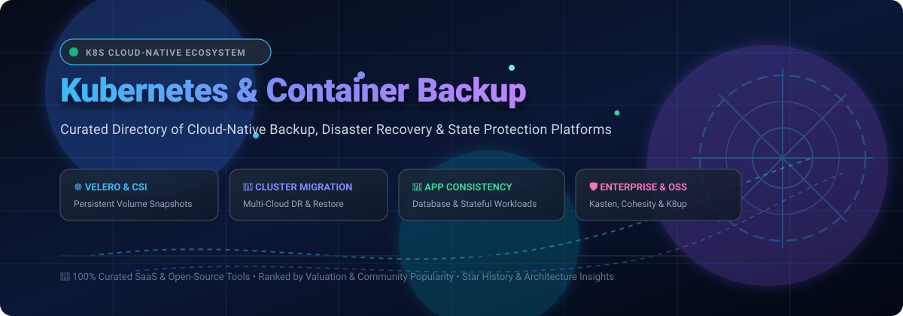

<p align="center">
  
</p>

# ☸️ Awesome Kubernetes & Container Backup 🛡️

<p align="center">
  <a href="https://github.com/ishandutta2007/Awesome-Awesome-Awesome"></a><a href="https://discord.gg/jc4xtF58Ve"></a>
  <a href="https://github.com/ishandutta2007/Awesome-Kubernetes-Container-Backup"></a>
  <a href="https://github.com/ishandutta2007/Awesome-Kubernetes-Container-Backup/network/members"></a>
  <a href="https://github.com/ishandutta2007"></a>
</p>

> 🚀 **A curated directory of top SaaS products and open-source GitHub projects for Kubernetes & Container Backup, Persistent Volume Protection, Disaster Recovery, CSI Snapshots, and Multi-Cluster Migration.**  
> 🌟 *Star this repository if you find it helpful!* 🌟

---

## 📑 Table of Contents
- [🌐 Sector Overview & Market Dynamics](#-sector-overview--market-dynamics)
- [🏢 Enterprise SaaS & Managed Kubernetes Backup Platforms](#-enterprise-saas--managed-kubernetes-backup-platforms)
- [🔓 Open-Source GitHub Projects & Operators](#-open-source-github-projects--operators)
- [📊 Architectural Comparison at a Glance](#-architectural-comparison-at-a-glance)
- [💡 Key Evaluation Criteria for K8s Backup](#-key-evaluation-criteria-for-k8s-backup)
- [⭐ Star History](#-star-history)
- [💖 Support & Community](#-support--community)
- [🤝 How to Contribute](#-how-to-contribute)
- [📄 License & Disclaimer](#-license--disclaimer)

---

## 🌐 Sector Overview & Market Dynamics

The global cloud-native and Kubernetes data protection market was estimated at **$2.9 billion in 2024** and is projected to surpass **$11.6 billion by 2033**, expanding at a robust compound annual growth rate (**CAGR**) of **16.7%**. This market expansion is primarily propelled by enterprise containerization of stateful databases (PostgreSQL, Kafka, MySQL, Redis), strict zero-trust recovery-time objectives (RTOs/RPOs), ransomware mitigation requirements requiring immutable air-gapped backups, and sovereign multi-cloud failover strategies.

The market structure is **moderately fragmented yet converging toward a bifurcated competitive landscape**: traditional enterprise data resilience titans (such as Commvault, Cohesity, Rubrik, and Veeam/Kasten) control large enterprise vendor-consolidation budgets across hybrid IT, while specialized cloud-native SaaS disruptors (such as CloudCasa by Catalogic, Portworx PX-Backup, and TrilioVault) compete fiercely alongside **dominant open-source foundational standards** (principally CNCF Velero, Kanister, and VolSync) which serve as the universal building blocks for cloud engineering teams globally.

---

## 🏢 Enterprise SaaS & Managed Kubernetes Backup Platforms

The following enterprise platforms offer managed SaaS control planes, multi-cluster policy orchestrators, ransomware detection, and commercial SLA support for Kubernetes container workloads. Entries are sorted descending by corporate size (market capitalization or latest enterprise valuation).

| Platform | Company Valuation / Annual Revenue | Starting Tier Pricing (Exact) | Free Tier / Trial Limit | Key Focus & Capabilities |
| :--- | :--- | :--- | :--- | :--- |
| **[Red Hat Advanced Cluster Management (RHACM)](https://www.redhat.com/en/technologies/management/advanced-cluster-management)** | **$34.0B** *(Acquired by IBM; IBM $210B+ cap)* | **$1,500/year** per 2-socket pair or standard managed cluster subscription node | **60-day free evaluation** (unlimited cluster management & OADP backup validation) | Fleet-scale OpenShift & K8s governance, automated cluster backup, disaster recovery, and GitOps policy management. |
| **[Veeam Kasten K10](https://www.kasten.io/)** | **$14.5B** *(Acquired by Insight Partners; Veeam ~$1.5B ARR)* | **$120/node/month** (Enterprise Tier, billed annually at $1,440/node/year) | **Free Forever**: Up to **10 worker nodes** with full core backup and restore capabilities | Purpose-built Kubernetes-native data management, policy automation, application-aware snapshots, and multi-cloud mobility. |
| **[Cohesity DataProtect for K8s](https://www.cohesity.com/)** | **$7.0B** *(Post-Veritas NetBackup unit merger valuation)* | **$35/managed node/month** (Enterprise consumption license starting tier) | **30-day free trial** (up to 25 worker nodes / 5 TB snapshot storage limit) | Unified data protection for hybrid IT, native Kubernetes namespace discovery, immutable snapshot vaults, and rapid DR. |
| **[Rubrik Security Cloud for K8s](https://www.rubrik.com/)** | **$6.8B** *(NYSE: RBRK public market capitalization)* | **$45/node/month** (Rubrik Foundation / SaaS edition starting tier) | **30-day free trial** (guided proof-of-concept with full automated SLA policy engines) | Zero-trust data security, anomaly detection, ransomware blast-radius analysis, and granular K8s object/PV recovery. |
| **[Commvault Cloud (Kubernetes Protection)](https://www.commvault.com/)** | **$6.2B** *(NASDAQ: CVLT public market capitalization)* | **$50/worker node/month** (Cloud Backup starting tier) | **30-day free trial** (unlimited cluster endpoints with 10 TB backup storage allowance) | Enterprise-scale container backup supporting EKS, AKS, GKE, and OpenShift with unified single-pane hybrid cloud policies. |
| **[Portworx PX-Backup (Pure Storage)](https://www.portworx.com/products/px-backup/)** | **$4.0B** *(Pure Storage subsidiary; NYSE: PSTG $19B cap)* | **$0.15/node/hour** (~$108/node/month via AWS/GCP/Azure Marketplaces) | **30-day free trial** (up to 15 nodes fully licensed on any cloud or on-prem cluster) | Granular container-native data management, multi-cloud cross-cluster restore, app-consistent CSI snapshot orchestration. |
| **[Druva Data Resiliency Cloud](https://www.druva.com/)** | **$2.0B** *(Enterprise private market valuation)* | **$2.50/GB/month** (or ~$30/resource unit/month on Druva Cloud platform) | **30-day free trial** (includes 1 TB of cloud storage backup quota) | 100% agentless SaaS data protection built on AWS, automated lifecycle tiering to Glacier Deep Archive, zero infra maintenance. |
| **[TrilioVault for Kubernetes (TVK)](https://trilio.io/)** | **$150M** *(Venture-backed Series B private valuation)* | **$30/node/month** (Basic Tier; Enterprise at $45/node/month billed annually) | **Free Forever**: Up to **10 nodes / 10 namespaces** forever without expiration | Cloud-native backup & restore management, RHACM and Rancher native UI integration, CSI volume snapshot scheduling. |
| **[CloudCasa by Catalogic](https://cloudcasa.io/)** | **$60M** *(Catalogic Software business division valuation)* | **$99/month** (Pro plan for up to 3 clusters and 10 worker nodes) | **Free Forever**: Unlimited cluster configuration backups; up to **100 GB PV data** free forever | Lightweight agentless SaaS control plane for Velero, multi-cloud K8s backup, automated cross-region and cross-account migration. |

---

## 🔓 Open-Source GitHub Projects & Operators

The open-source ecosystem forms the absolute bedrock of cloud-native backup. Projects below are sorted descending by GitHub community Stars_Count, featuring real-time stargazers badges.

| Repository & Stargazers | GitHub_Stars_Badge | Primary Language / Stack | Ecosystem Role & Description |
| :--- | :--- | :--- | :--- |
| **[kubernetes/kubernetes](https://github.com/kubernetes/kubernetes)** | [](https://github.com/kubernetes/kubernetes/stargazers) | Go | The container orchestration control plane. Standardizes etcd snapshot workflows, VolumeSnapshot CRDs, and CSI backup primitives. |
| **[restic/restic](https://github.com/restic/restic)** | [](https://github.com/restic/restic/stargazers) | Go | Secure, deduplicated, and encrypted backup program frequently leveraged as the underlying data mover in Velero, Stash, and K8up. |
| **[kopia/kopia](https://github.com/kopia/kopia)** | [](https://github.com/kopia/kopia/stargazers) | Go | Fast, encrypted deduplication backup engine used by modern Velero releases as the preferred snapshot and node-agent repository mover. |
| **[vmware-tanzu/velero](https://github.com/vmware-tanzu/velero)** | [](https://github.com/vmware-tanzu/velero/stargazers) | Go | The industry-standard open-source Kubernetes backup, restore, and cluster migration framework. Backs up manifests and PVs to object storage. |
| **[openebs/openebs](https://github.com/openebs/openebs)** | [](https://github.com/openebs/openebs/stargazers) | Go / C | Container Native Storage (CNS) platform featuring built-in incremental snapshots, local volume backup, and cloud archival targets. |
| **[cloudnative-pg/cloudnative-pg](https://github.com/cloudnative-pg/cloudnative-pg)** | [](https://github.com/cloudnative-pg/cloudnative-pg/stargazers) | Go | CNCF Graduated Postgres operator with native WAL archiving, continuous streaming backup, and Barman Cloud point-in-time recovery (PITR). |
| **[longhorn/longhorn](https://github.com/longhorn/longhorn)** | [](https://github.com/longhorn/longhorn/stargazers) | Go | Cloud-native distributed block storage for Kubernetes featuring automated snapshot scheduling and direct incremental volume backups to S3/NFS. |
| **[kubevirt/kubevirt](https://github.com/kubevirt/kubevirt)** | [](https://github.com/kubevirt/kubevirt/stargazers) | Go | Virtualization add-on for Kubernetes providing virtual machine snapshot APIs, memory freeze hooks, and guest disk disaster recovery integrations. |
| **[zalando/postgres-operator](https://github.com/zalando/postgres-operator)** | [](https://github.com/zalando/postgres-operator/stargazers) | Python | Production-tested PostgreSQL operator managing multi-node high availability with automated S3/GCS WAL-E/WAL-G continuous backups. |
| **[kubernetes-sigs/cluster-api](https://github.com/kubernetes-sigs/cluster-api)** | [](https://github.com/kubernetes-sigs/cluster-api/stargazers) | Go | Declarative cluster lifecycle management tooling paired with backup tools for reproducible automated disaster recovery of entire cluster topologies. |
| **[stashed/stash](https://github.com/stashed/stash)** | [](https://github.com/stashed/stash/stargazers) | Go | Enterprise-grade backup operator for Kubernetes by AppsCode. Provides database-consistent dumps (MySQL, Mongo, PG) and volume protection. |
| **[neuvector/neuvector](https://github.com/neuvector/neuvector)** | [](https://github.com/neuvector/neuvector/stargazers) | C / Go | Open-source container security platform by SUSE offering continuous compliance, backup verification scanning, and vulnerability auditing. |
| **[backube/volsync](https://github.com/backube/volsync)** | [](https://github.com/backube/volsync/stargazers) | Go | Asynchronous 1-to-1 and 1-to-many persistent volume replication operator leveraging CSI snapshots, rsync, and Restic for active-passive cluster DR. |
| **[k8up-io/k8up](https://github.com/k8up-io/k8up)** | [](https://github.com/k8up-io/k8up/stargazers) | Go | CNCF Sandbox project providing a clean, CRD-based operator to schedule application and volume backups using Restic to any S3 backend. |
| **[kanisterio/kanister](https://github.com/kanisterio/kanister)** | [](https://github.com/kanisterio/kanister/stargazers) | Go | Extensible application-level data management framework. Enables blueprint hooks for pre/post-quiesce application database consistency. |
| **[percona/percona-xtradb-cluster-operator](https://github.com/percona/percona-xtradb-cluster-operator)** | [](https://github.com/percona/percona-xtradb-cluster-operator/stargazers) | Go | Cloud-native MySQL operator automating full and incremental physical backups using Percona XtraBackup to AWS S3 and MinIO. |
| **[kubedb/docs](https://github.com/kubedb/docs)** | [](https://github.com/kubedb/docs/stargazers) | Go / Docs | Comprehensive tooling and documentation for running, snapshotting, and restoring production stateful databases natively on Kubernetes. |

---

## 📊 Architectural Comparison at a Glance

```
       ┌────────────────────────────────────────────────────────┐
       │             Kubernetes Control Plane (etcd)            │
       │           Backups: Velero / etcdctl / Cluster-API       │
       └───────────────────────────┬────────────────────────────┘
                                   │
       ┌───────────────────────────┴────────────────────────────┐
       │             Application Workload Pods (Stateful)       │
       │         Blueprints & Quiescing: Kanister / Stash       │
       └───────────────────────────┬────────────────────────────┘
                                   │
            ┌──────────────────────┴──────────────────────┐
            ▼                                             ▼
  ┌───────────────────┐                         ┌───────────────────┐
  │ CSI Block Storage │                         │ File-Level & Logs │
  │ Snapshots (CSI/   │                         │ Node Movers:      │
  │ Longhorn/OpenEBS) │                         │ Kopia / Restic    │
  └─────────┬─────────┘                         └─────────┬─────────┘
            │                                             │
            └──────────────────────┬──────────────────────┘
                                   ▼
        ┌───────────────────────────────────────────────────┐
        │        S3 / GCS / Azure Blob / Tape Archive       │
        │    Vaulting: AWS Glacier, Cohesity, CloudCasa     │
        └───────────────────────────────────────────────────┘
```

| Dimension | Open-Source Foundation (e.g. Velero + Kopia) | Enterprise SaaS (e.g. Kasten, Commvault, Cohesity) |
| :--- | :--- | :--- |
| **Cost Profile** | Zero licensing fees; compute and S3 storage costs only | Predictable subscription per node ($30–$150/mo) |
| **Management Plane** | CLI / YAML CRD manifests, custom Grafana dashboards | Centralized multi-cluster UI, RBAC, tenant self-service |
| **Application Quiescing** | Manual pre/post-backup hook scripting via Kanister/Stash | Automated out-of-the-box catalog of database blueprints |
| **Ransomware Defense** | Object lock policies configured manually on S3 buckets | AI-driven anomaly detection, honey-token alerts, air gaps |
| **Restore Speed** | CSI volume snapshot restore + parallel chunk hydration | Instant instant-mount, live cloning, and continuous DR |

---

## 💡 Key Evaluation Criteria for K8s Backup

When planning backup and disaster recovery for containerized workloads, consider these essential technical factors:

1. ⚡ **CSI Volume Snapshot Support**: Ensure your storage class implements the Container Storage Interface (CSI) specification for snapshot and restore APIs without detached volume unmounting.
2. 🔒 **Application Consistency vs. Crash Consistency**: Standard filesystem snapshots can cause database corruption without pre-backup locks (`FLUSH TABLES WITH READ LOCK`, `pg_start_backup`) and post-backup unlocks. Use blueprints (such as Kanister or Stash).
3. 📦 **Namespace & Cluster Metadata Completeness**: Backing up PVCs alone is insufficient; CRDs, secrets, configmaps, service accounts, and ingress definitions must be preserved synchronously.
4. 🛡️ **Air-Gapped & Immutable Storage**: Backups must be secured in S3 compliant buckets utilizing Object Lock (WORM - Write Once Read Many) with separate IAM credentials to withstand cluster-level ransomware attacks.
5. 🧪 **Automated Restore Testing**: Regularly test restore operations on a staging cluster. A backup that has never been restored is merely an assumption.

---

##  Star History

[](https://www.star-history.com/#ishandutta2007/Awesome-Kubernetes-Container-Backup&type=date&legend=top-left)

---

## 💖 Support

Thank you for visiting and using this curated directory! If you find this project helpful or valuable for your cloud-native architecture, Kubernetes deployments, and container data protection strategies, please consider supporting it:

- ⭐ **Star this repository** to improve discoverability for fellow platform engineers and SREs
- 🍴 **Fork and contribute** new open-source backup tools, CSI operators, or benchmarks
- 📢 **Share** this repository with your DevOps, cloud engineering, and Kubernetes communities
- ☕ **Buy me a coffee / Sponsor**: If you would like to support ongoing curation and maintenance of open-source knowledge bases, please visit the [Sponsor Dashboard](https://github.com/sponsors/ishandutta2007)

---

## 🤝 How to Contribute

Contributions are warmly welcomed! 🙌 To add or update a Kubernetes backup tool or operator:

1. 🍴 **Fork the repository**
2. 🌿 **Create a feature branch** (`git checkout -b feature/add-k8s-backup-tool`)
3. ✍️ **Add your entry** following the table format (ensure exact starting prices, trial limits, and proper stargazer badges)
4. 💾 **Commit your changes** (`git commit -m 'Add [Tool Name] to Kubernetes Backup'`)
5. 🚀 **Push to your branch** (`git push origin feature/add-k8s-backup-tool`)
6. 📬 **Open a Pull Request** with a brief summary of the project

---

## 📄 License & Disclaimer

- **License**: Distributed under the [MIT License](LICENSE).
- **Disclaimer**: This is an independent community-curated directory. Product names, logos, and brands are the property of their respective owners. Pricing, free tier limits, and valuations fluctuate over time and reflect publicly verifiable data.
